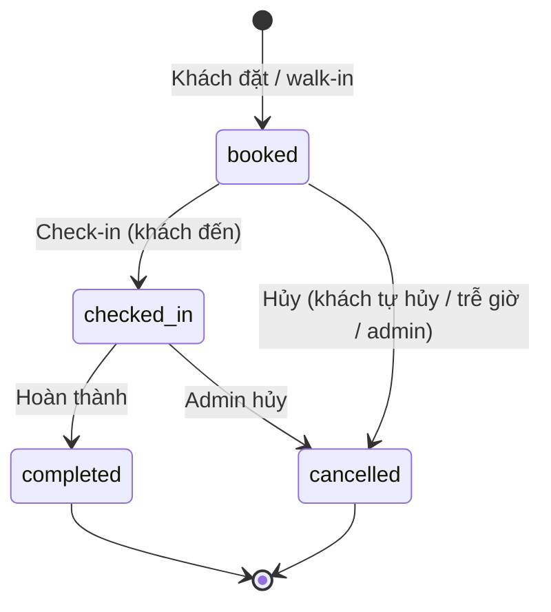

# Đặc tả yêu cầu phần mềm (SRS)
## Hệ thống đặt lịch Ngói Photobooth

| | |
|---|---|
| Phiên bản | 1.0 |
| Ngày | 26/11/2026 |
| Phạm vi | Website đặt lịch cho khách + website quản lý cho nhân viên, 2 chi nhánh tại Huế |
| Công nghệ | PHP 8.3, Laravel 12, Livewire 4, Tailwind CSS 4, MySQL 8, Redis |
| Tài liệu liên quan | `docs/kien-truc.md`, `docs/api.md`, `docs/database.md`, `docs/workflow-du-an.md`, `docs/giam-sat.md`, `docs/hieu-nang.md` |

---

## 1. Giới thiệu

### 1.1 Mục đích
Ngói Photobooth cần hệ thống đặt phòng chụp online thay cho việc ghi sổ tay và nhắn tin. Khách đến quầy hoặc
nhìn bảng tại cửa hàng để lấy **mã truy cập 6 số của ngày**, vào website chọn chi nhánh, phòng, khung giờ
10 phút và đặt lịch. Nhân viên xem lịch theo lưới giờ, check-in, hủy, hoàn thành và xem thống kê doanh thu.

### 1.2 Thuật ngữ

| Thuật ngữ | Nghĩa |
|-----------|-------|
| Slot | Một khung 10 phút của một phòng, ví dụ Phòng 1 lúc 14:30–14:40 |
| Booking | Một slot đã được giữ cho khách. Một lần đặt nhiều slot tạo nhiều booking chung một **mã booking** |
| Mã truy cập | Mã 6 số, đổi mỗi ngày theo giờ Việt Nam, dùng chung cho 2 chi nhánh |
| Mã booking | Mã dạng `NGxxxxxx` khách đưa cho nhân viên khi đến |
| Walk-in | Khách đặt trực tiếp tại quầy, nhân viên nhập vào hệ thống |
| Giờ VN | Múi giờ Asia/Ho_Chi_Minh (UTC+7) |

### 1.3 Đối tượng sử dụng

| Vai trò | Mô tả | Truy cập |
|---------|-------|---------|
| Khách hàng (customer) | Người muốn chụp ảnh | Đăng ký / đăng nhập, cần mã truy cập ngày để đặt lịch |
| Nhân viên (staff) | Trực quầy | Website admin, đăng nhập email + mật khẩu |
| Chủ cửa hàng (owner) | Quản lý | Như nhân viên + sửa phòng, giá |

---

## 2. Mô tả tổng quan

### 2.1 Kiến trúc
Một ứng dụng **Laravel 12**: giao diện khách và quản lý viết bằng **Blade + Livewire + Tailwind** (thư mục `frontend/`),
logic nghiệp vụ và **REST API** (Sanctum) ở `backend/`, dữ liệu lưu ở **MySQL**, cache và hàng đợi dùng **Redis**.
Chi tiết: `docs/kien-truc.md`.

### 2.2 Dữ liệu danh mục ban đầu

| Chi nhánh | Địa chỉ | Phòng |
|-----------|---------|-------|
| 36 Nguyễn Sinh Cung | Vỹ Dạ, Huế | Phòng 1 Vintage, Phòng 2 Classic, Phòng 3 Film |
| 88 Đinh Tiên Hoàng | Phú Xuân, Huế | Phòng 1 Vintage, Phòng 2 Classic, Phòng 3 Film |

Giá mặc định 50.000đ / slot. Nguồn: `data/catalog/*.json`.

### 2.3 Ràng buộc
- Chạy tốt trên điện thoại (khách chủ yếu dùng điện thoại) và máy tính bảng/máy tính tại quầy.
- Giao diện tiếng Việt. Mọi ngày giờ hiển thị và tính toán theo giờ VN, **do máy chủ quyết định** (không tin đồng hồ máy khách).
- Ngăn đặt trùng phải được đảm bảo ở tầng database, không chỉ ở giao diện.

---

## 3. Quy tắc nghiệp vụ

| Mã | Quy tắc | Cách hệ thống đảm bảo |
|----|---------|----------------------|
| BR-01 | Mã truy cập 6 số đổi mỗi ngày theo giờ Việt Nam | `app.timezone = Asia/Ho_Chi_Minh`; bảng `access_codes` khóa theo ngày; mã sinh ngẫu nhiên lần đầu được hỏi trong ngày |
| BR-02 | Một mã dùng chung cho cả 2 chi nhánh | Mã không gắn chi nhánh |
| BR-03 | Chỉ đặt lịch trong ngày hiện tại | `BookingService` tự dùng ngày VN hiện tại, không nhận ngày từ client; mã đã nhập chỉ có hiệu lực trong ngày |
| BR-04 | Giờ hoạt động 08:30–22:30 | Cột `open_time`, `close_time` của chi nhánh; slot cuối bắt đầu 22:20 |
| BR-05 | Mỗi slot 10 phút | Giờ đặt phải nằm đúng lưới 08:30, 08:40, … |
| BR-06 | Không đặt trùng: một phòng chỉ có 1 booking mỗi slot | Chỉ số UNIQUE `(room_id, booking_date, slot_time, active_slot)`; booking hủy có `active_slot = NULL` nên slot được giải phóng |
| BR-07 | Khách cần đến đúng giờ; quá giờ có thể bị hủy | Lệnh `bookings:cancel-no-shows` chạy mỗi 5 phút, tự hủy booking quá 15 phút chưa check-in; nhân viên cũng có nút "Hủy vì trễ giờ" |
| BR-08 | Khách online không đặt slot đã bắt đầu | So với giờ VN của máy chủ |
| BR-09 | Walk-in được đặt slot đang diễn ra (chưa kết thúc) | Kiểm tra riêng cho nguồn `walkin` |
| BR-10 | Khách tự hủy được trước giờ chụp, chỉ khi còn trạng thái Đã đặt | `BookingPolicy`: khách chỉ thao tác booking của mình |
| BR-11 | Mỗi lần đặt online tối đa 12 slot (2 giờ) | Kiểm tra ở API |
| BR-12 | Doanh thu chỉ tính booking Hoàn thành; giá lưu tại thời điểm đặt | Cột `bookings.price` |

### 3.1 Vòng đời trạng thái booking

| Trạng thái | Nhãn | Màu |
|------------|------|-----|
| `booked` | Đã đặt | Vàng cam |
| `checked_in` | Đang chụp | Xanh dương |
| `completed` | Hoàn thành | Xám |
| `cancelled` | Đã hủy | Đỏ nhạt |

---

## 4. Yêu cầu chức năng

### 4.1 Website khách hàng

| Mã | Chức năng | Mô tả & tiêu chí chấp nhận |
|----|-----------|---------------------------|
| FR-U00 | Đăng ký / đăng nhập | Đăng ký: họ tên, email, SĐT, mật khẩu ≥ 8 ký tự có chữ và số. Form có CSRF, kiểm tra phía server, báo lỗi tiếng Việt. Đăng nhập sai 5 lần khóa 1 phút |
| FR-U01 | Nhập mã truy cập | Ô nhập 6 số. Sai → báo "Mã chưa đúng". Quá 20 lần/10 phút → tạm khóa. Đúng → vào bước chọn chi nhánh, nhớ trong phiên đến hết ngày |
| FR-U02 | Chọn chi nhánh | Hiện 2 chi nhánh: tên, địa chỉ, giờ mở cửa, số phòng. Chọn 1 |
| FR-U03 | Chọn phòng | Hiện phòng đang hoạt động: tên, phong cách, mô tả, giá/slot. Chọn được nhiều phòng |
| FR-U04 | Chọn khung giờ | Lưới slot 10 phút, chia theo khoảng 2 giờ, mở sẵn khoảng giờ hiện tại. Slot đã đặt / đã qua bị gạch, không bấm được. Chọn nhiều slot, xem tổng tiền. Lịch tự làm mới mỗi 30 giây |
| FR-U05 | Xác nhận | Hiện lại chi nhánh, phòng, giờ, tổng tiền. Nhập tên (bắt buộc) và SĐT VN 10 số. Nếu slot vừa bị người khác đặt → quay lại bước 4, bỏ slot đó, báo rõ |
| FR-U06 | Thành công | Hiện mã booking `NGxxxxxx`, chi tiết, mã **VietQR** để chuyển khoản trước, gửi **email xác nhận** qua hàng đợi |
| FR-U09 | Thời tiết | Trang chủ và bước chọn giờ hiện thời tiết Huế hôm nay từ **Open-Meteo** (cache 30 phút, API lỗi thì ẩn) |
| FR-U07 | Lịch của tôi | Liệt kê booking của tài khoản (phân trang); tự hủy các slot chưa bắt đầu (có bước xác nhận) |
| FR-U08 | Liên hệ | Gửi lời nhắn (chi nhánh, chủ đề, tên, SĐT/email, nội dung). Xem địa chỉ, link Google Maps |

### 4.2 Website quản lý

| Mã | Chức năng | Mô tả & tiêu chí chấp nhận |
|----|-----------|---------------------------|
| FR-A01 | Đăng nhập | Dùng chung trang đăng nhập; tài khoản role staff/owner được chuyển vào /admin |
| FR-A02 | Mã truy cập hôm nay | Luôn hiển thị trên trang Lịch phòng. Trang Cài đặt cho phép tạo mã mới khi bị lộ |
| FR-A03 | Lịch phòng | Lưới giờ × phòng theo chi nhánh và ngày; màu theo trạng thái; lọc khoảng 2 giờ; ẩn/hiện giờ đã qua; đếm Chờ check-in / Đang chụp / Hoàn thành / Đã hủy; tự làm mới 30 giây |
| FR-A04 | Chi tiết booking | Bấm ô có khách → xem tên, SĐT (bấm gọi), phòng, giờ, giá, nguồn, trạng thái, nút thao tác |
| FR-A05 | Walk-in | Bấm ô trống "+" → nhập tên, SĐT → tạo booking nguồn "Tại quầy" |
| FR-A06 | Quản lý booking | Bảng lọc theo chi nhánh, ngày, trạng thái (tab Tất cả / Đã đặt / Đang chụp / Hoàn thành / Đã hủy), tìm theo tên/SĐT/mã |
| FR-A07 | Check-in / Hoàn thành / Hủy | Chỉ hiện thao tác hợp lệ theo vòng đời 3.1. Hủy cần xác nhận, chọn "Hủy" hoặc "Hủy vì trễ giờ" |
| FR-A08 | Thống kê & báo cáo | Chọn chi nhánh, 7/30/90 ngày: tổng lượt đặt theo ngày, doanh thu theo ngày, hiệu suất từng phòng (tỉ lệ lấp đầy), báo cáo theo chi nhánh, bảng số liệu, xuất CSV |
| FR-A09 | Phòng & giá | Owner sửa tên, phong cách, mô tả, giá (bội số 1.000đ), bật/tắt phòng, thêm phòng. Staff chỉ xem |
| FR-A10 | Lời nhắn | Xem lời nhắn khách gửi, đánh dấu đã đọc/chưa đọc |
| FR-A11 | Đổi mật khẩu | Cần mật khẩu hiện tại, mật khẩu mới ≥ 8 ký tự |
| FR-A12 | Giám sát | Chủ cửa hàng xem Telescope (request, query, job, lỗi) và Pulse (máy chủ, query chậm, cache) |
| FR-API | REST API | API cho ứng dụng di động / đối tác: CRUD chi nhánh, phòng, booking, lời nhắn, token Sanctum, tài liệu Scramble tại `/docs/api` |

---

## 5. Use case chính

### UC-01 Khách đặt lịch
1. Khách mở website, nhập mã truy cập (FR-U01).
2. Chọn chi nhánh → phòng → khung giờ (FR-U02..04).
3. Nhập tên, SĐT, bấm **Xác nhận đặt lịch** (FR-U05).
4. Hệ thống kiểm tra lại toàn bộ quy tắc BR-03..BR-08, BR-11 trong một giao dịch, ghi booking.
5. Hiện mã booking (FR-U06).

**Luồng phụ 4a:** slot vừa có người đặt → trả lỗi 409 `SLOT_TAKEN`, giao diện quay lại bước 3 và bỏ slot đó.
**Luồng phụ 4b:** slot đã qua giờ → 409 `SLOT_PAST`.
**Luồng phụ 1a:** sang ngày mới khi đang đặt → mã hết hiệu lực → về bước nhập mã.

### UC-02 Nhân viên tiếp khách
1. Khách đến, đọc mã booking hoặc tên.
2. Nhân viên tìm trên Lịch phòng hoặc Quản lý booking, bấm **Check-in** → Đang chụp.
3. Chụp xong bấm **Hoàn thành** → tính vào doanh thu.
4. Khách không đến sau giờ hẹn → **Hủy vì trễ giờ**, slot được giải phóng.

### UC-03 Khách vãng lai tại quầy
Nhân viên bấm ô trống trên Lịch phòng → nhập tên, SĐT → booking "Tại quầy".

---

## 6. Yêu cầu phi chức năng

| Mã | Yêu cầu |
|----|---------|
| NFR-01 Hiệu năng | API phản hồi < 300 ms cho lịch 1 chi nhánh/ngày với 3 phòng × 84 slot |
| NFR-02 Đồng thời | Hai khách bấm cùng một slot cùng lúc: đúng 1 người thành công (có test tự động) |
| NFR-03 Bảo mật | Mật khẩu băm bcrypt; CSRF cho mọi form; token Sanctum có ability; Policy phân quyền; giới hạn số lần nhập mã/đăng nhập; Eloquent dùng tham số |
| NFR-04 Khả dụng | Responsive từ 360px; hỗ trợ chế độ tối theo hệ thống; thao tác bàn phím, nhãn cho trình đọc màn hình |
| NFR-05 Triển khai | Docker Compose 1 lệnh; CI chạy lint + test (SQLite và MySQL) + build Docker mỗi PR |
| NFR-07 Giám sát | Health check `/api/health`; log nghiệp vụ, log truy vấn chậm; Telescope, Pulse |
| NFR-06 Sao lưu | Sao lưu MySQL hằng ngày (hướng dẫn trong `deploy/README.md`) |

---

## 7. Giao diện

Thiết kế theo prototype `design/prototypes/*.html` và sơ đồ `docs/assets/system-workflow.jpg`.
Bảng màu và font: `design/figma/README.md`.

## 8. Ngoài phạm vi phiên bản 1.0
- Thanh toán online, đặt cọc.
- Đặt lịch cho ngày khác ngày hiện tại.
- Gửi SMS/Zalo tự động.
- Gửi link ảnh sau buổi chụp (prototype có, để phiên bản sau).
