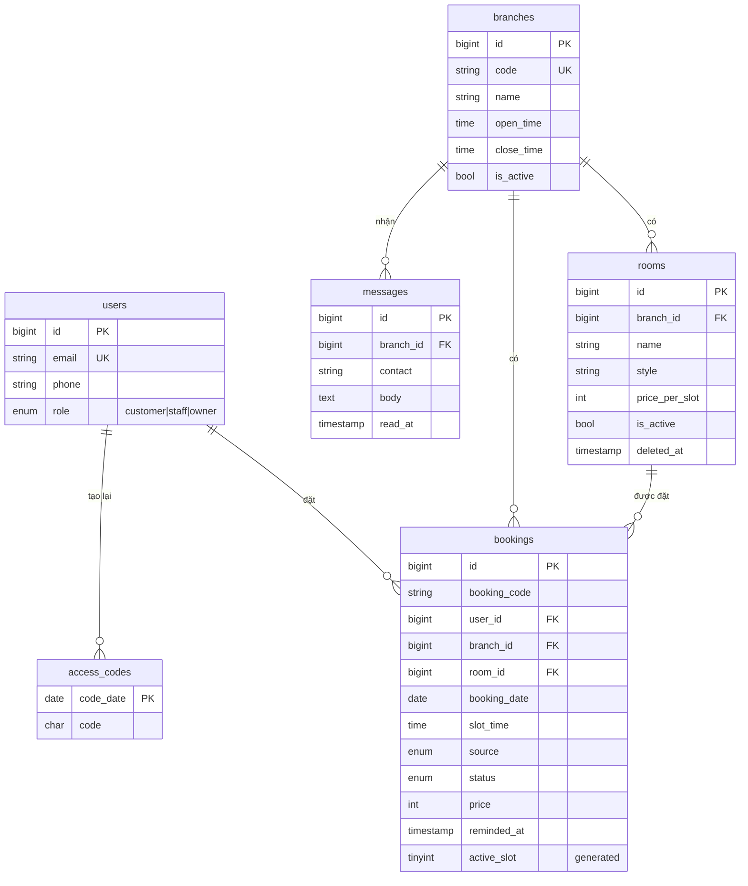

# Database

Migration: `backend/database/migrations`. Seeder: `backend/database/seeders`. Factory: `backend/database/factories`.



Ngoài ra Laravel tạo: `sessions`, `cache`, `jobs`, `failed_jobs`, `personal_access_tokens` (Sanctum),
`telescope_entries*`, `pulse_*`.

## Chỉ số

| Bảng | Chỉ số | Phục vụ |
|------|--------|---------|
| bookings | `UNIQUE(room_id, booking_date, slot_time, active_slot)` | Chống đặt trùng (BR-06) |
| bookings | `(branch_id, booking_date)` | Lưới lịch, lịch trống |
| bookings | `(booking_date, status)` | Thống kê, lệnh tự hủy |
| bookings | `booking_code`, `customer_phone` | Tìm kiếm |
| rooms | `(branch_id, is_active)` | Danh sách phòng hoạt động |
| users | `role` | Lọc nhân viên |

## Seeder

| Seeder | Dữ liệu |
|--------|---------|
| `CatalogSeeder` | 2 chi nhánh, 6 phòng từ `data/catalog/*.json` (chạy lại an toàn) |
| `UserSeeder` | `admin@ngoi.vn` (owner), `nhanvien@ngoi.vn` (staff), `khach@ngoi.vn` + 20 khách (mật khẩu `password`) |
| `BookingSeeder` | ~2.600 booking 31 ngày, đủ trạng thái, chèn theo lô 500 dòng |
| `MessageSeeder` | 6 lời nhắn |

```bash
php artisan migrate:fresh --seed
```
