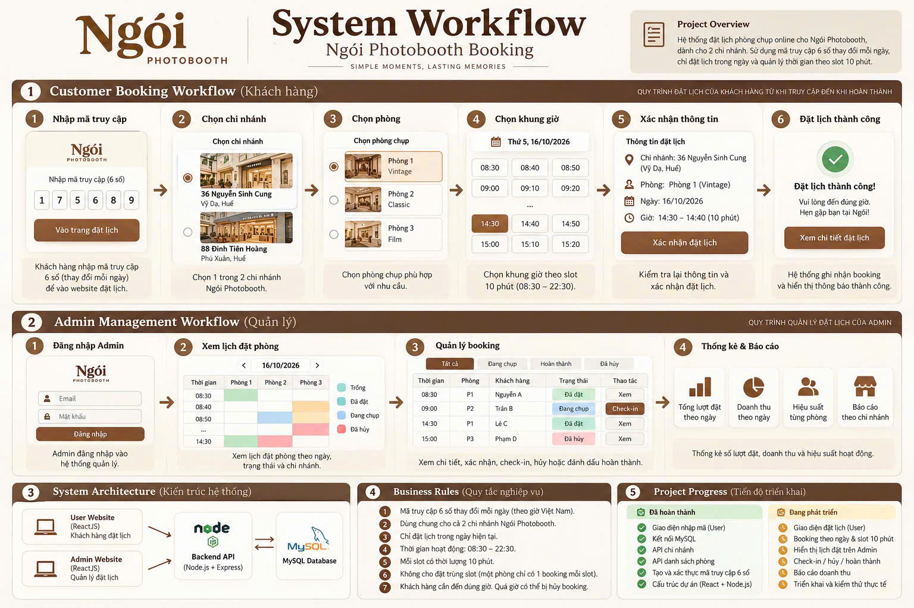
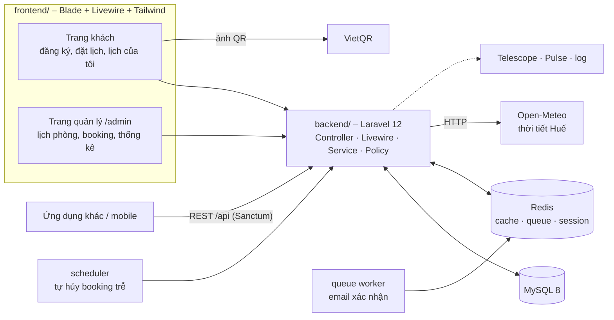

# Kiến trúc hệ thống





## Cấu trúc repo

| Thư mục | Nội dung |
|---------|----------|
| `backend/` | Ứng dụng Laravel: `app/` (Models, Services, Http, Livewire, Jobs, Policies…), `database/` (migration, seeder, factory), `routes/`, `tests/` (Pest), `config/` |
| `frontend/resources/views` | Blade layout, trang, component, view của Livewire |
| `frontend/resources/css`, `js` | Tailwind CSS 4 + design tokens, JS |
| `data/catalog` | Dữ liệu gốc chi nhánh, phòng (seeder đọc từ đây) |
| `deploy/` | Dockerfile, docker-compose (app, queue, scheduler, pulse, mysql, redis) |
| `design/` | Token màu/font, prototype HTML gốc |
| `docs/` | Đặc tả, kiến trúc, API, database, giám sát, hiệu năng, workflow |
| `scripts/` | Cài đặt, chạy dev, chạy test, tạo Issue GitHub |
| `.github/` | GitHub Actions, mẫu Issue, mẫu PR |

Laravel được cấu hình đọc view ở `../frontend/resources/views` (`backend/config/view.php`, `config/livewire.php`)
và Vite build CSS/JS từ `../frontend/resources` (`backend/vite.config.js`).

## Các lớp trong backend

```
backend/app
├── Enums/            BookingStatus (vòng đời + nhãn + màu), BookingSource, UserRole
├── Models/           User, Branch, Room (xóa mềm), Booking, AccessCode, Message
├── Services/         BookingService, AvailabilityService, AccessCodeService, ReportService,
│                     WeatherService (Open-Meteo), VietQr
├── Http/Controllers/ Api/ (resource controller REST) · Web/ (đăng ký, đăng nhập, trang tĩnh)
├── Http/Requests/    FormRequest kiểm tra dữ liệu (API và web)
├── Http/Resources/   JsonResource định dạng dữ liệu API
├── Livewire/         Customer/ (BookingWizard, MyBookings) · Admin/ (Schedule, Bookings, Reports, Rooms, …)
├── Policies/         BookingPolicy, RoomPolicy, BranchPolicy
├── Jobs/             SendBookingConfirmation (queue)
├── Observers/        Xóa cache khi booking / phòng thay đổi
├── Console/Commands/ bookings:cancel-no-shows (scheduler)
├── Exceptions/       BookingException: lỗi nghiệp vụ có mã (SLOT_TAKEN, SLOT_PAST…)
└── Support/          SlotClock (giờ VN, lưới slot), Phone (chuẩn hóa SĐT)
```

Controller API và component Livewire đều gọi chung **Service**, nên quy tắc nghiệp vụ chỉ viết một lần.

## Phân quyền

| Vai trò | Web | API (ability của token) |
|---------|-----|------------------------|
| customer | Đặt lịch, lịch của mình | `customer`: xem/đặt/hủy booking của mình |
| staff | + /admin (trừ Phòng) | `customer`, `staff`: + /api/admin/*, walk-in, đổi trạng thái |
| owner | + Phòng, Telescope, Pulse | như staff + CRUD chi nhánh/phòng, xóa booking (Policy) |

## Chống đặt trùng
Kiểm tra ở giao diện chỉ để báo sớm. Bảo đảm thật nằm ở database: cột sinh
`active_slot = CASE WHEN status='cancelled' THEN NULL ELSE 1 END` và chỉ số
`UNIQUE (room_id, booking_date, slot_time, active_slot)`. Hai request cùng slot thì request sau gặp
`UniqueConstraintViolationException`, service ném `BookingException::slotTaken` (HTTP 409) và giao dịch được rollback.
