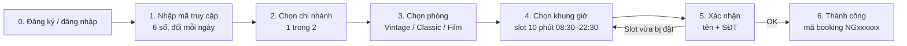
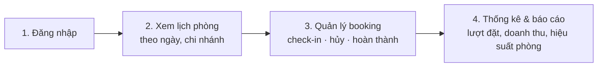
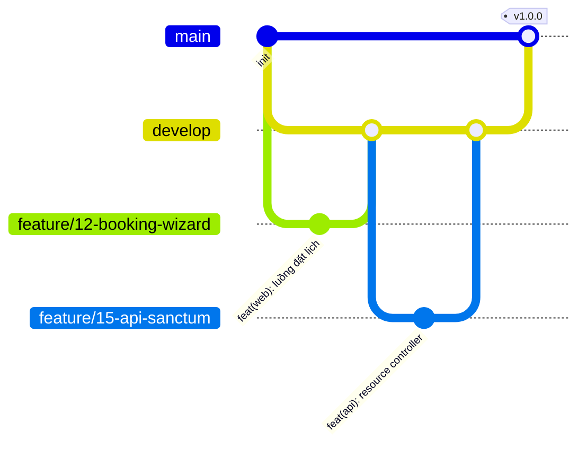
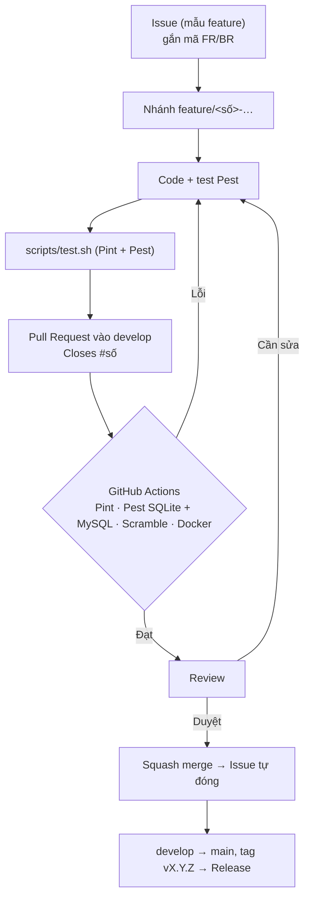

# Workflow dự án

Tài liệu mô tả **quy trình nghiệp vụ** (khách và admin dùng hệ thống thế nào) và **quy trình làm việc của nhóm**
(chia việc, Git, review, CI/CD, triển khai). Sơ đồ tổng: `docs/assets/system-workflow.jpg`.

---

## Phần A. Quy trình nghiệp vụ

### A1. Khách đặt lịch (6 bước)



### A2. Admin quản lý (4 bước)



### A3. Một ngày vận hành tại cửa hàng
1. **08:00** Nhân viên đăng nhập admin, xem mã truy cập hôm nay, ghi lên bảng tại quầy / màn hình.
2. **Trong ngày** Khách quét/đọc mã → đặt online. Khách vãng lai → nhân viên bấm ô trống tạo walk-in.
3. Khách đến → tìm theo mã booking → **Check-in**. Chụp xong → **Hoàn thành**.
4. Khách trễ quá giờ hẹn → **Hủy vì trễ giờ** để nhường slot.
5. **Cuối ngày** Xem Thống kê hôm nay, xuất CSV nếu cần đối soát.
6. **Tự động** Mỗi 5 phút hệ thống hủy booking quá 15 phút chưa check-in; tin Zalo xác nhận, báo hủy và nhắc giờ chụp gửi khách qua hàng đợi (không dùng email).
7. **00:00** Hệ thống tự dùng mã mới cho ngày hôm sau.

---

## Phần B. Quy trình làm việc của nhóm

### B1. Vai trò

| Vai trò | Phụ trách |
|---------|-----------|
| Trưởng nhóm / PO | Đặc tả (`docs/dac-ta-yeu-cau.md`), tạo và ưu tiên Issue, duyệt PR vào `main` |
| Frontend | `frontend/resources` (Blade, Livewire view, Tailwind), `design/` |
| Backend | `backend/app`, `backend/database`, `backend/routes`, API |
| DevOps / Tester | `.github/workflows`, `deploy/`, `scripts/`, test Pest, giám sát |

### B2. Quản lý công việc bằng GitHub Issues
- Mỗi chức năng/lỗi là 1 Issue, dùng mẫu trong `.github/ISSUE_TEMPLATE` (ghi mã yêu cầu FR/BR).
- Nhãn: `feature`, `bug`, `frontend`, `backend`, `devops`, `docs`. Issue mới chưa nhãn được workflow `issue-triage.yml` gắn `cần phân loại`.
- Bảng GitHub Projects: cột *Todo → In progress → Review → Done*. PR ghi `Closes #<số>` để Issue tự đóng khi merge.
- Backlog ban đầu tạo bằng `scripts/create-github-issues.sh owner/repo` (xem `docs/huong-dan-github.md`).

### B3. Nhánh Git



- `main`: bản chạy thật, chỉ nhận merge từ `develop` hoặc `hotfix/*`, mỗi lần gắn tag `vX.Y.Z` (workflow Release đẩy image).
- `develop`: bản tích hợp.
- `feature/<số-issue>-<mô-tả>`, `fix/<số-issue>-<mô-tả>`, `hotfix/<mô-tả>`.
- Bảo vệ nhánh `main`, `develop`: bắt buộc PR, CI xanh, ≥ 1 review.

### B4. Quy ước commit (Conventional Commits)

```
<type>(<phạm vi>): <mô tả ngắn, thì hiện tại>

<giải thích vì sao, nếu cần>

Closes #12
```

`type`: `feat`, `fix`, `docs`, `test`, `refactor`, `perf`, `chore`, `ci`. Phạm vi: `web`, `api`, `db`, `booking`, `admin`, `ci`…
Ví dụ: `feat(booking): chặn đặt slot đã qua giờ (BR-08)`, `fix(api): trả 409 khi đặt trùng`, `test(web): thêm test lịch của tôi`.
Mỗi commit một thay đổi trọn vẹn, chạy được test.

### B5. Quy trình một chức năng



### B6. GitHub Actions (`.github/workflows`)

| Workflow | Khi chạy | Việc |
|----------|---------|------|
| `ci.yml` | Push / PR vào `main`, `develop` | **lint** (Pint) → **test** (Pest, ma trận SQLite + MySQL 8.4, có coverage, kiểm tra `migrate:fresh --seed`) · **api-docs** (Scramble analyze + export) → **docker** (build image) |
| `release.yml` | Gắn tag `v*.*.*` | Build và đẩy image lên GHCR, tạo GitHub Release |
| `issue-triage.yml` | Mở Issue | Gắn nhãn `cần phân loại` nếu chưa có |

### B7. Definition of Done
- Đúng tiêu chí trong đặc tả / Issue; có test Pest; CI xanh; Pint không lỗi.
- Giao diện chạy được trên điện thoại 360px và máy tính.
- Cập nhật `docs/` nếu đổi API, bảng, quy tắc.

### B8. Tiến độ

| Hạng mục | Trạng thái |
|----------|-----------|
| Cấu trúc dự án Laravel, CI | ✅ |
| Migration, seeder, factory | ✅ |
| Đăng ký / đăng nhập, mã truy cập 6 số | ✅ |
| Đặt lịch 6 bước, lịch của tôi | ✅ |
| Admin: lịch phòng, booking, thống kê, phòng, lời nhắn | ✅ |
| REST API + Sanctum + Scramble | ✅ |
| Telescope, Pulse, log, cảnh báo query chậm | ✅ |
| Queue email, scheduler tự hủy, cache | ✅ |
| Triển khai máy chủ thật, HTTPS, SMTP | ⏳ |
| UAT tại 2 chi nhánh | ⏳ |
